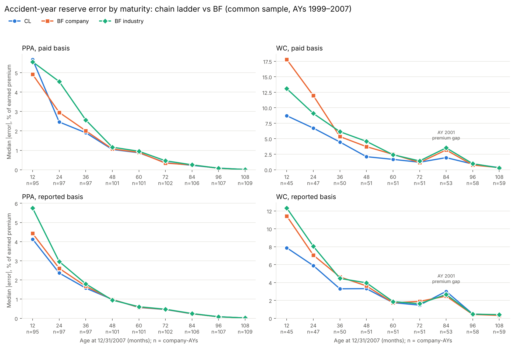
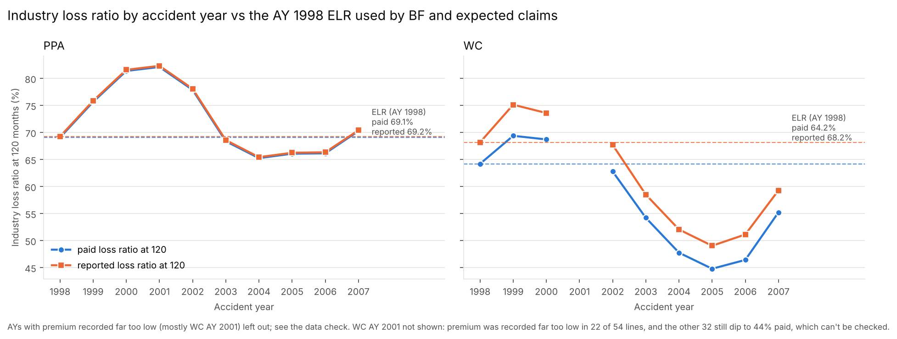

# Reserving Backtest: How Accurate Are Basic Reserving Methods on Real Insurers?

> Status: Phase 1 (data) and Phase 2 (one company by hand) complete. Phase 3 (all companies) next. The question, target and scoring rules below were set **before** any estimates were made, so the design can't be tuned to the results.

## Research question

How accurate are basic reserving methods on real insurers, and what drives the errors when they miss?

I run paid and reported chain ladder, the expected claims method and Bornhuetter-Ferguson on every company-line that passes the cleaning rules (109 PPA, 60 WC), using only the data available at 12/31/2007. Then I grade every estimate against how the losses actually developed over the next 10 years.

Specific questions:
1. Which method is most accurate on total reserves, by line?
2. How does error change with accident-year maturity?
3. Paid vs reported basis: which is more accurate, and does the answer differ between PPA and WC?
4. Which development-factor averaging method works best?
5. How sensitive is BF to the choice of expected loss ratio?

## Data

- **Source:** CAS Loss Reserving Database (NAIC Schedule P), newer release: accident years 1998–2007, valued 12/31/2007, with actual development through 2016. [CAS page](https://www.casact.org/publications-research/research/research-resources/loss-reserving-data-pulled-naic-schedule-p) Downloaded: 2026/10/29
- **Lines:** Private passenger auto (PPA) and workers' compensation (WC).
- **Column mapping:**
  - Paid = `CumPaidLoss`
  - Reported (paid + case) = `IncurredLosses − BulkLoss`
  - Premium = `EarnedPremNet`
## Data cleaning

Rules are judged on known cells only (valuation 12/31/2007) and were frozen before any estimates. Full reasons and evidence: [docs/cleaning_rules.md](docs/cleaning_rules.md). Code: `src/clean.py`. Dropped lines: [docs/dropped_lines.csv](docs/dropped_lines.csv).

| Step | PPA lines | PPA graded AYs | WC lines | WC graded AYs |
|---|---|---|---|---|
| Start | 143 | 1,182 | 132 | 1,078 |
| Rule 1: no paid losses in any known cell | 135 | 1,125 | 106 | 868 |
| Rule 2: net earned premium ≤ 0 in any AY | 113 | 951 | 63 | 501 |
| Rule 4: any negative case reserve > 10% of paid | 109 | 915 | 60 | 474 |

A graded AY is an accident year 1999–2007 that is present (AY 1998's reserve is zero at the valuation date). Rules 3 and 5–8 are notes and drop nothing: changes in ceded share of premium (reinsurance), negative bulk reserves, lines missing their latest AYs (graded on the AYs present), company size, and groups vs single companies (both kept).

**Sample size.** WC ends at 60 lines, below the original target of 100. Rather than drop BF and expected claims for WC, results report n and interval widths, methods are compared on the same company-lines, and comparisons are paired (per-company error differences).

**Limitations from cleaning:**
- *Survivorship:* lines that stopped filing before 2007 can't be graded. Companies that exit or fail likely reserved worse, so measured errors are probably a lower bound, and the bias can narrow gaps between methods.
- *Selection (rule 2):* dropped lines may lean toward runoff, heavily reinsured or pooled companies.
- *Reinsurance:* Schedule P doesn't record treaty type, so changes in excess-of-loss reinsurance are a possible driver of chain ladder errors that can't be separated out.
- *Groups:* group membership can change through mergers between 2007 and 2016.

## Phase 2: one company by hand (WC, GRCODE 23663)

Before scaling up, every method was built by hand in Excel on one randomly picked mid-size WC company ([excel/wc_23663.xlsx](excel/wc_23663.xlsx)), rebuilt in Python (`src/methods.py`, checked against Friedland ch. 7 Exhibit I in `tests/`) and reconciled to the workbook at every stage, both bases (largest gap $0.07; `notebooks/03_one_company.ipynb`). A written prediction ([notes/phase2_prediction.md](notes/phase2_prediction.md)) was committed with the estimates (tag `phase2-freeze`) before the answer key was opened (`notebooks/04_phase2_reveal.ipynb`).

| Basis | Closest method | Error, % of reserve | Actual unpaid, AYs 1999–2007 ($000) |
|---|---|---|---|
| Paid | Chain ladder | −4.4% | 13,659 |
| Reported | Chain ladder | +11.5% | 14,436 |

- **Prediction:** 3 of 7 calls hit. The diagnostics were read correctly (the AY 1998 loss ratio overstated recent AYs; case reserves strengthened), but I picked BF to hedge against AY 1998-style late emergence, which didn't happen.
- **Main driver:** AYs 2002–2007 finished at 38–58% paid loss ratios, well below the expected loss ratios (company AY 1998: 84.1%; industry: 64.2%). BF and expected claims lean on those ratios, so they overstated; chain ladder used each AY's own losses.
- **Judgment vs averages:** my factor selections beat all 6 averages on the reported basis (+11.5% vs +25% to +60%). On the paid basis every averaging method landed within ±10%.
- **Changes for Phase 3:** accident-year errors are shown as % of earned premium, because % of reserve explodes on mature AYs (AY 2000's actual unpaid was $12K). The loss ratio options stay as set; changing them after one result would be hindsight. Question 5 tests the loss ratio effect across every line.

## Phase 3: every method on every clean line

All 40 combinations per accident year were run on all 169 clean lines (PPA 109, WC 60; 1,558 company-AYs): chain ladder under 6 averages × 2 bases, expected claims with 2 loss ratios × 2 bases, and BF with 6 averages × 2 loss ratios × 2 bases. `src/backtest.py` runs `src/methods.py` (unchanged from Phase 2) on every line on known cells only, with an assertion that no cell after 2007 enters. The estimates were frozen (tag `phase3-freeze`; SHA-256 hashes in [notes/phase3_freeze.md](notes/phase3_freeze.md)) before `notebooks/05_phase3_grade.ipynb` read any later development. Factors are mechanical averages only; no judgment.

- **Checks before the freeze:** GRCODE 23663 run through the batch reproduces all 16 Phase 2 totals (chain ladder under each average, expected claims with each loss ratio, both bases); BF = Z × CL + (1 − Z) × EC with Z = 1/CDF holds on every checkable BF row, which catches misaligned CDF, premium or loss ratio joins; `tests/test_backtest.py` covers the zero-denominator rule, "latest n" with a gap and incomplete lines.
- **Rules set before grading:** an AY whose starting cumulative is 0 is left out of that age's average, and a factor with no AY left is 1.0. Four WC lines have AY 1998 losses of 0, so their company loss ratio is 0; they are kept and flagged. One WC line (26956) has a 0 reported CDF from a $1K drop at lag 8 → 9, so its reported BF is undefined; it is left out of method comparisons (common sample: PPA 109, WC 59 lines).
- **Results file:** [docs/phase3_summary.csv](docs/phase3_summary.csv) has n, median, IQR and median absolute error on both scales for every line of business × basis × method × average × loss ratio; [docs/phase3_open_case_by_line.csv](docs/phase3_open_case_by_line.csv) has case still open at 120 by line.

Headline comparison, common sample, AYs 1999–2007, chain ladder and BF on volume-weighted all-years factors. Median error as % of reserve on line totals (median absolute error in brackets); lines whose actual unpaid total is ≤ 0 have no % of reserve (PPA 8, WC 3 paid / 1 reported).

| Line, basis | Chain ladder | BF, company LR | BF, industry LR | EC, company LR | EC, industry LR |
|---|---|---|---|---|---|
| PPA paid | +6.9% (18.8%) | +7.8% (22.8%) | +14.8% (22.3%) | −18.8% (103.4%) | +42.4% (95.7%) |
| PPA reported | +3.2% (14.7%) | +4.5% (12.8%) | +3.9% (15.9%) | −16.9% (102.9%) | +31.7% (94.1%) |
| WC paid | +4.5% (28.5%) | +0.7% (41.9%) | +19.9% (32.5%) | −35.3% (133.6%) | +26.5% (78.5%) |
| WC reported | +5.0% (27.8%) | +2.7% (26.2%) | +11.7% (29.6%) | −40.9% (119.8%) | +27.1% (87.7%) |

Findings, error drivers and intervals are in Phase 4 (below).

## Phase 4: findings

From the frozen Phase 3 estimates; nothing re-estimated. Notebook: [notebooks/06_phase4_evaluate.ipynb](notebooks/06_phase4_evaluate.ipynb). Common sample (PPA 109, WC 59 lines), AYs 1999–2007, chain ladder (CL) and BF on volume-weighted all-years factors. Error = estimate − actual; positive = over-reserved.

1. **Chain ladder was as accurate as BF and far more accurate than expected claims.** Paired comparison per line (CL |error| − other |error|, % of reserve, median with 95% bootstrap interval, 10,000 resamples): vs expected claims, −43 to −89 points, every interval below 0; vs BF, −8.9 to +0.9 points, every interval contains 0 (a tie). Closest to a CL edge: WC paid vs BF with the company loss ratio, −8.9 points (−17.1, +0.0). Results: [docs/phase4_q1_paired.csv](docs/phase4_q1_paired.csv).
2. **Error is concentrated in the youngest accident years.** Median |error| as % of earned premium falls with age for CL and BF; on WC paid, CL 8.7% at 12 months vs BF 13–18%, all within about 1 point by 72 months. Expected claims doesn't improve with age (its error ÷ EP = expected loss ratio − actual loss ratio). WC errors are 1.5–2× PPA's.
   
3. **BF and expected claims missed on WC because the AY 1998 loss ratio overstated later years.** The WC industry loss ratio at 120 months fell from 64% (AY 1998, the expected loss ratio) to 45–55% (AYs 2003–2007); PPA stayed within about 4 points. BF error = Z × CL error + (1 − Z) × expected claims error exactly (Z = 1/CDF); on WC paid with the industry loss ratio, the median BF error of +19.9% has a loss ratio term of +26.0% and a development term of +1.0%. With hindsight loss ratios, BF's median |error| on WC paid would have been 13.7% vs CL's 28.5%: BF's long-tail advantage is real but only as good as its loss ratio, and this project's is an unadjusted AY 1998 ratio (no rate-change or trend data). A company's own AY 1998 ratio is unbiased but noisy; the industry ratio was more accurate for BF on WC paid (paired +11.5 points, interval +6.3 to +20.1).
   
4. **Paid vs reported (short).** Median |error|, paid vs reported: PPA CL 18.8% vs 14.7%, BF 22.8% vs 12.8%; WC CL 28.5% vs 27.8%, BF 41.9% vs 26.2%. Reported unpaid includes case still open at 120 months (median 15.1% of reported unpaid for WC, 0.5% for PPA), so the WC comparison is approximate.
5. **Averaging methods (short, in-sample).** Latest-3 averages rank first on PPA (paid 15.4% vs 18.8% for the headline average; reported 8.8% vs 14.7%); on WC the six are within about 4 points. Only the headline average was chosen in advance, so the winners' edge is likely overstated.

**Limitations.**
- *Survivorship:* only companies that filed through 2007 can be graded; exits and failures likely had less stable development, so errors are likely a lower bound, and CL, which leans most on each company's own history, likely gains most.
- *Premium recorded far too low:* 25 company-AYs (22 of 54 WC lines in AY 2001) have earned premium a few percent of the line's other years with normal losses. Rule 2 caught premium = 0 but not near-zero premium; known data would have shown it before the freeze. Frozen results are kept; removing those AYs moves CL and BF by 1 point or less and makes expected claims worse ([docs/phase4_premium_sensitivity.csv](docs/phase4_premium_sensitivity.csv)).
- *Reinsurance changes:* lines whose ceded share of premium swung by more than 0.5 are kept; Schedule P doesn't record treaty type, so this is a named confounder only. On WC these lines were under-reserved by CL at the median, the opposite of the excess-of-loss mechanism (21 lines; observation, not finding).
- *No claim counts, rate changes or trend:* settlement speed vs case strength can't be separated, and the expected loss ratio can't be adjusted.

## Target definition

- **Target:** cumulative losses at 120 months of development (lag 10). The data contains this value for every accident year, so no tail factor is needed. Development factors run to 120 months and stop.
- **Caveat:** for WC, 120 months is not ultimate. The paid-to-reported ratio at lag 10 shows how much remains open.
- **Target per method:** Matching basis: paid methods are graded against paid at 120 and reported methods against reported at 120. Expected claims and BF are each run twice: once using paid losses, paid development factors and a paid expected loss ratio, and once using the reported versions of all three. Each run is graded against the matching target. Why: stopping at 120 months (no tail factors) leaves case reserves open at lag 10, so paid and reported at 120 differ. A common target would count that gap as error for one chain ladder, and the gap varies by line and maturity. Open case at 120 is reported separately by line.

## Backtest design

- **Blind split:** a cell (accident year, lag) is *known* if AY + lag − 1 ≤ 2007; otherwise it is *hidden*. Estimates are frozen before the hidden data is opened.
- **Error is measured on the reserve, not the ultimate:**
  error = (estimated unpaid − actual unpaid) / actual unpaid.
  It is also reported as a percentage of earned premium. AY 1998 is excluded from the reserve error because its reserve is zero by construction.
- **Summary statistics:** medians and IQRs across companies. Bias (median signed error) is reported separately from accuracy (median absolute error).
- **Known limitation:** selecting the best averaging method and scoring it on the same data is an in-sample comparison; stated with the Phase 4 results. The second-era (1988–1997) extension would fix it.

## Scope

**In scope:** paid/reported chain ladder, expected claims, BF; 6 averaging methods (simple and volume-weighted × all years, latest 5, latest 3; Friedland ch. 7); 2 expected loss ratio options (company AY 1998 at 120 months; premium-weighted industry); PPA and WC; 120-month target.

**Out of scope:** tail factors, Mack/bootstrap, Berquist-Sherman, frequency-severity methods, case outstanding development. The data has no claim counts, so a shift in the paid-to-reported ratio can't be attributed to faster settlement vs. weakening case reserves.

## Repository layout

```
data/raw/        CAS download, unmodified
data/clean/      output of src/clean.py (not committed; rebuild by running it)
docs/            cleaning rules, cleaning counts, dropped lines, data dictionary;
                 Phase 3 summary results and open case at 120 by line;
                 Phase 4 result tables (phase4_*.csv) and figures/
data/hidden/     Phase 2 answer key (not committed)
results/         Phase 3 estimates and graded tables (not committed; rebuild with src/backtest.py
                 and notebooks/05_phase3_grade)
excel/           Phase 2 hand-built exhibits, WC GRCODE 23663
notes/           Phase 2 prediction, written before the reveal; Phase 3 freeze hashes
src/             clean.py (cleaning rules); methods.py (triangles, factors, averages, CL, expected claims, BF, grading);
                 backtest.py (Phase 3: loss ratios, all lines x 40 combinations, checks)
notebooks/       01_data_checks (probes behind each rule), 02_clean (applies the rules),
                 03_one_company (pick, export, Python-to-Excel reconciliation), 04_phase2_reveal (grading),
                 05_phase3_grade (grades every estimate, summary table),
                 06_phase4_evaluate (the five questions, error drivers, data check)
tests/           test_methods.py: Friedland ch. 7 Exhibit I (factors, averages, CDFs, chain ladder);
                 test_backtest.py: Phase 3 batch (23663 regression, zero denominators, latest n, incomplete lines)
```

## References

- Friedland, *Estimating Unpaid Claims Using Basic Techniques* (CAS)
- ASOP No. 23, Data Quality
